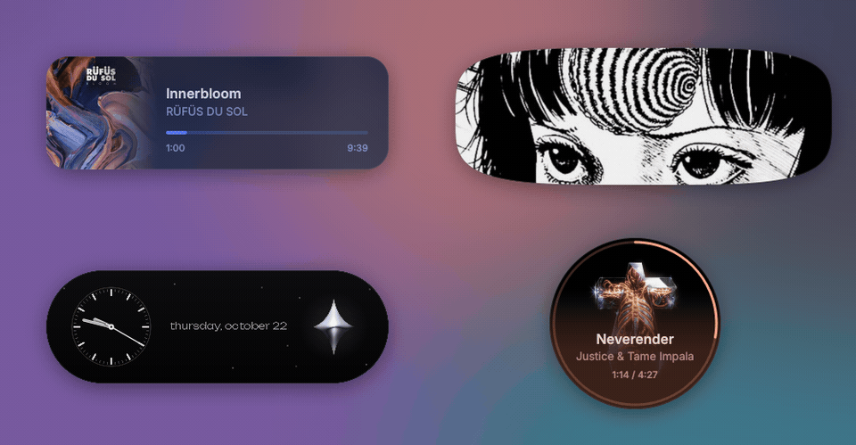
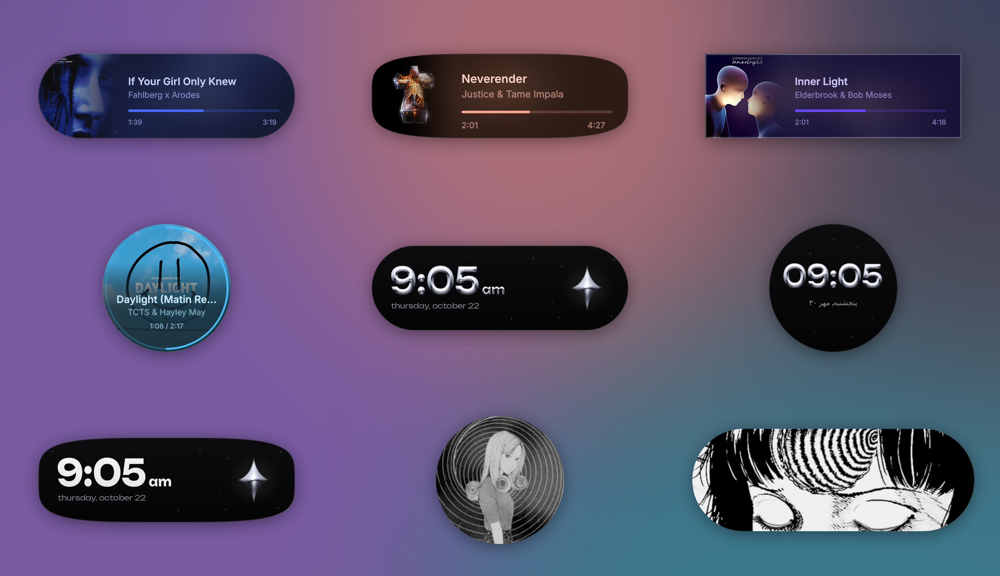
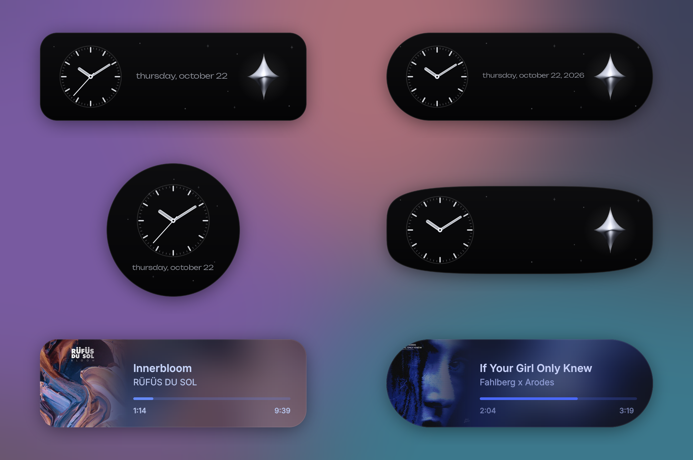
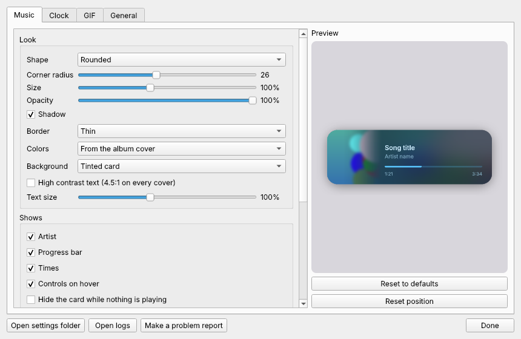
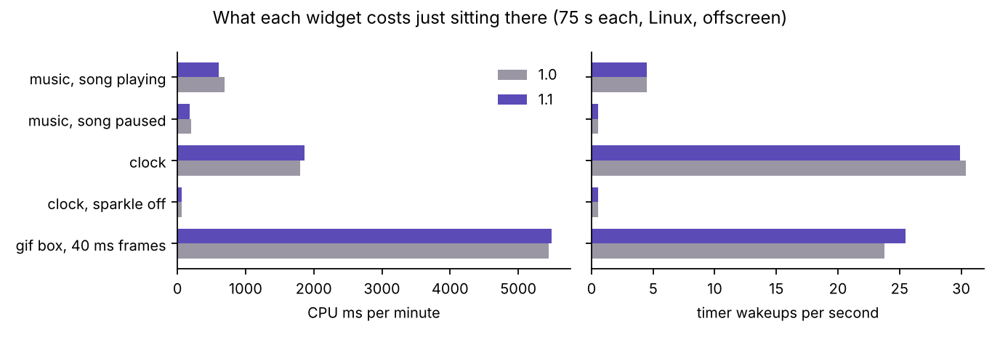
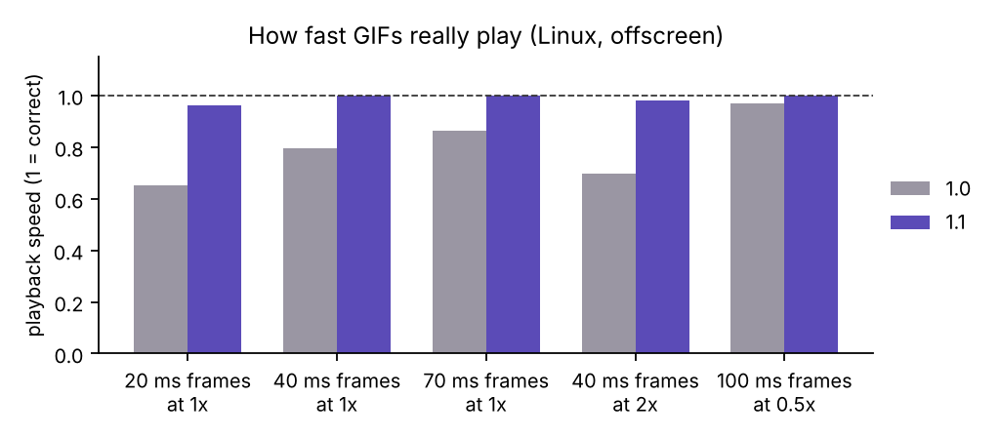
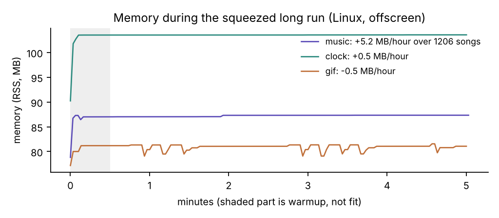
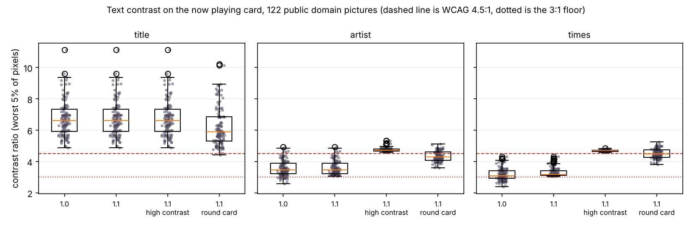

# Aura

Aesthetic desktop widgets for Windows. A now playing card for Spotify that takes its colors from the album cover, rounded GIF boxes that loop your favorite GIFs, and a clock in 3D liquid chrome.

## Demo

These are drawn by the widgets' own code, offscreen on Linux, so the text font is Inter instead of Windows' Segoe UI. The songs are from my own playlist, shown with their real album covers, which belong to the artists and their labels (listed in `results/demo_credits.json`). The GIFs are fan art of Junji Ito's Uzumaki, and the wide one is by holique.

## Install

1. Install [Python 3.12+](https://www.python.org/downloads/) and check **Add python.exe to PATH**
2. Download this repo and double click `install.bat`
3. Double click any `.pyw` file to open that widget, then right click it for options

The Windows build in GitHub Actions also makes an installer, `AuraSetup-1.1.0.exe`, which you can download as an artifact from a run. It installs for your user only, needs no admin rights and can turn on open with Windows. Uninstall it from Windows settings like any app.

To remove the source version, double click `uninstall.bat`. It closes the widgets, turns off open with Windows, and asks before deleting your settings. You can also install the requirements yourself with `pip install -r requirements.txt`.

## What changed in 1.1

My question for this version was whether widgets that run all day on a gaming PC can stay cheap, steady and readable, and how I would show that. The full list is in [CHANGELOG.md](CHANGELOG.md). With the default settings these are the main differences from 1.0.

* Every card still draws what 1.0 drew. A test renders both versions side by side and compares every pixel. The only exception is text that 1.0 made too faint to read.
* The 1.0 fullscreen check kept 6.3 KB of memory every time it ran, and it runs every 2 seconds. That adds up to about 270 MB a day per widget. The new check keeps nothing.
* A 20 ms GIF played at 0.65x speed in 1.0 and a GIF set to 2x played at 0.70x. Now they play at 0.96x and 0.98x.
* I put 122 public domain paintings through the card as album covers. In 1.0 the time was under 3:1 contrast on 44 of them. Now no line of text is under 3:1, and the high contrast setting takes every line to 4.5:1.
* The new options are all off by default. They are shapes (rounded, square, squircle, pill, circle), an analog clock face, a blurred cover background, a GIF or picture behind the clock, the date in 16 languages, a GIF folder that rotates, a finder for GIFs on your PC, snapping, a shortcut that hides every widget, saved profiles, settings export and import, a tray icon, opacity, click through and more. Dragging the progress bar to seek is on, and you can switch it off.
* 253 tests run on Linux with the Windows media session faked. CI also runs them on Windows, checks the real Windows APIs, builds the exe and the installer, and installs and uninstalls it.

The numbers in the Performance section come from a Linux machine with the widgets drawing offscreen. I still need to measure on Windows, and [docs/windows_benchmark.md](docs/windows_benchmark.md) says how.

## Widgets

**Now playing (`aura_widget.pyw`)**
* Album art dissolves into a rounded card tinted with the cover's main color
* Title, artist and progress bar are colored to match each song
* Smooth crossfade between songs, with playback controls on hover
* Click or drag the progress bar to jump anywhere in the song
* Drag the card from anywhere except the progress bar, since pressing on the bar seeks
* Reads playback through the Windows media session, so no Spotify login or API key is needed
* Option to put the blurred cover behind the card instead of the tint, with the text lifted where it would be hard to read
* Option to hide the card 15 seconds after the player closes, and show it again when music starts

**GIF boxes (`aura_gif.pyw`, `aura_gif_tall.pyw`)**
* Loops any GIF or animated WebP forever inside a rounded card
* Adjustable speed from 0.25x to 2x, pause and play
* Resize by dragging the edges, and hold Ctrl while dragging to choose which part of the GIF shows
* Copy the file under a new name to get another independent box
* Can play every GIF in a folder, switching every few minutes
* Find a GIF in a folder searches your PC by file name (subfolders too) and shows thumbnails, from the right click menu or the settings window

**Clock (`aura_clock.pyw`)**
* Time in 3D liquid chrome using the Unbounded font, with the date underneath
* A 3D chrome star that softly shines every few seconds, plus tiny twinkling stars
* Uses your PC's clock, with 12 or 24 hour time and optional seconds
* Optional GIF or picture behind the time, any font, and the date in other languages (Persian uses the Persian calendar)
* Analog face with chrome hands and a second hand if you turn seconds on. The date sits beside the dial, or under it on the round card

**All widgets**
* Drag anywhere on the desktop, and positions are remembered for each monitor
* Right click, Settings opens one window for every widget, with a live preview
* Optional launch at startup, tray icon, lock, click through and opacity
* Reset position sends a widget back to its default spot, from its right click menu, the tray or the settings window
* Snap to screen edges, the middle of the screen and other widgets while you drag. Hold Alt to drag freely
* A shortcut you turn on in Settings (it starts as Ctrl+Alt+A, and you can pick any key with Ctrl, Alt or Win) that hides every widget and brings them back. The tray menu and `python aura.py hide`, `show` and `toggle` do the same
* Profiles save every setting and every position under a name, so you can switch between a work and a gaming layout. Export and import move your settings to another PC as a JSON file, without positions
* A short note on the very first run says where things are. It shows once, and not at all if you already used Aura
* Automatically pause while a fullscreen game or video is open
* Nothing is injected into other programs, which keeps them friendly with game anti cheat

Every setting is listed in [docs/settings.md](docs/settings.md).

## Performance

Measured here on Linux, offscreen, on a shared 2 core machine.

| | 1.0 | 1.1 | File |
|---|---|---|---|
| Memory kept by the fullscreen check, per call | 6316 bytes | 0.1 bytes | `ctypes_leak.json` |
| GIF speed, 20 ms frames at 1x (1.00 is right) | 0.65 | 0.96 | `gif_timing.json` |
| GIF speed, 40 ms frames at 1x (1.00 is right) | 0.80 | 1.00 | `gif_timing.json` |
| GIF speed, 70 ms frames at 1x (1.00 is right) | 0.87 | 1.00 | `gif_timing.json` |
| GIF speed, 40 ms frames at 2x (1.00 is right) | 0.70 | 0.98 | `gif_timing.json` |
| CPU per minute, music, song playing | 0.70 s | 0.61 s | `idle.json` |
| CPU per minute, music, song paused | 0.20 s | 0.18 s | `idle.json` |
| CPU per minute, clock | 1.80 s | 1.87 s | `idle.json` |
| CPU per minute, clock, sparkle off | 0.06 s | 0.06 s | `idle.json` |
| CPU per minute, gif box, 40 ms frames | 5.44 s | 5.49 s | `idle.json` |
| New song (decode, palette, card), CPU | 14.4 ms | 16.2 ms | `render_bench_linux.json` |
| Music card frame, CPU | 0.8 ms | 0.7 ms | `render_bench_linux.json` |
| Clock frame, CPU | 2.8 ms | 1.7 ms | `render_bench_linux.json` |
| GIF frame scaled to the card, CPU | 2.8 ms | 2.7 ms | `render_bench_linux.json` |
| Memory (RSS) while idle, music, song playing | 77 MB | 78 MB | `idle.json` |
| Memory (RSS) while idle, clock | 100 MB | 103 MB | `idle.json` |
| Memory (RSS) while idle, gif box, 40 ms frames | 75 MB | 76 MB | `idle.json` |

The GIF box draws more often in 1.1 (25.0 paints a second against 23.2 for the same 40 ms GIF) because it now plays at the right speed, so its CPU per minute is about the same as 1.0. The clock frame got cheaper because the letters, the date and the shadow are converted once to the format Qt draws with. The pixels didn't change, and `tests/test_defaults_match_v1.py` still passes. That doesn't show up in the idle CPU, since the clock mostly redraws small areas. A new song costs about 2 ms more in 1.1 because of the text contrast check. The clock uses about 3 MB more memory in 1.1 and I haven't worked out why yet.

### Memory over a long run

I squeezed hours of use into 5 minutes with the fake media session. The music widget went through 1206 song changes, the clock got 1000 events with seconds on and the GIF box got 1199 events. Memory after the first 30 seconds and at the end was as follows.

* music, 87.0 and 87.3 MB
* clock, 103.5 and 103.6 MB
* GIF box, 81.2 and 80.8 MB

The fitted slopes are 5.24, 0.52 and -0.52 MB an hour. The music slope comes from one 0.3 MB step at about two minutes and the line is flat apart from that, so I don't read it as a leak. A real overnight run on Windows is still needed.

### Text contrast

I put 122 public domain paintings from The Met through the real card and measured the text against the pixels behind it using WCAG contrast.

* In 1.0 the title was always above 4.5:1, with 4.88 as the lowest.
* In 1.0 the artist line was under 4.5:1 on 115 covers and under 3:1 on 11, with 2.58 as the lowest.
* In 1.0 the times were under 3:1 on 44 covers, with 2.39 as the lowest.
* In 1.1 nothing is under 3:1 and the lowest is 3.05. Text got a little brighter on 55 covers and the rest are drawn as in 1.0.
* With high contrast on, the lowest is 4.57.

## How it works

* Now playing data comes from the Windows `GlobalSystemMediaTransportControlsSessionManager` API through the `winrt` Python bindings, polled on a background asyncio thread and passed to the UI with Qt signals. Every call has a 5 second timeout, and the manager is asked for again if reads keep failing
* Seeking sends `TryChangePlaybackPositionAsync` in 100 ns ticks. While you drag, and for a moment after, updates from Windows that still carry the old position are ignored, so the bar doesn't jump back. Players that don't allow seeking just don't get the drag
* Color palette is pulled from the cover with median cut quantization in Pillow, scored by how common and how saturated each color is, then turned into background, text and accent shades in HSV. Then each line of text is checked against the real pixels behind it and lifted only if it would fall under 3:1
* Rendering uses PyQt6 with a frameless translucent window, antialiased clipping to the card's shape, a gradient alpha mask for the art fade and a pre blurred drop shadow. Text rows stack from the title down and stop where the shape curves in, so they never overlap
* GIF playback uses a custom frame scheduler that follows each frame's own delay, applies the same minimum delay rule browsers use, and keeps frames on a timeline so decoding time doesn't slow the GIF down
* Game detection checks every two seconds whether the foreground window covers the whole monitor, using Win32 calls through `ctypes`
* 3D chrome text turns each letter into a height map, works out which way every pixel faces, and shades it like a polished metal reflection with NumPy. Each character is rendered once and reused, so updating the time costs almost nothing
* Settings live in one ini file per widget, all defined in one list in `aura_common.py`. That list drives the settings window, the checks on every value and `docs/settings.md`. Widgets watch their file and apply changes right away
* Errors go to `%APPDATA%\Aura\logs`, capped at about 4 MB per widget. "Make a problem report" in Settings zips the logs and settings onto your Desktop after telling you what's in it. Nothing is ever sent anywhere

## Tests

`python -m pytest -q tests` runs 253 tests offscreen in about 2 minutes on my test machine.

* `tests/original/` keeps the 1.0 files untouched. With default settings every card in every state (playing, paused, crossfading, hovering, 12 and 24 hour, seconds, GIF fill and fit at three sizes) has to match 1.0 pixel for pixel at 1x, 1.5x and 2x.
* Every card records where it drew each piece. For every shape, corner radius, text size, show combination, long and short title, hover and seek state, and 11 languages, no two pieces may overlap and nothing may stick out of the shape.
* A fake media session covers switching players, the player closing, covers that show up late or fail, a call that never answers, the service not being ready at login, a stale manager, and seeking with a player that reports the new position late.
* Each widget's real `main()` runs with default settings and with heavy settings, and its log has to stay free of errors. The settings window changes a running widget live, and closing it leaves the widget running.
* The extras have their own tests. Snapping is checked as plain geometry and through two widgets that find each other's files. Hiding goes through the shared file, including a stale flag from last time. The shortcut text is parsed for every key form it accepts and rejects, profiles and imports are tried with broken and hostile files, a running GIF box loads a file chosen in the settings window, and a running music card hides and returns. The analog dial is checked for overlap in every shape, size, language and date format, and its hands are checked to point where the time says.
* Regression tests cover the memory leak, an error inside a Qt event, choosing the GIF that is already showing, a GIF that can't be decoded, copies of the GIF file and a monitor that disappears.
* On Windows, CI also runs `tests/windows_checks.py` against the real winrt, user32 and registry, builds `Aura.exe` and `AuraSetup-1.1.0.exe`, runs each widget for 10 seconds from the exe, and installs and uninstalls silently.

## Rerun everything

    python bench/run_all.py

That runs the tests and every measurement above and rebuilds the figures, the README pictures and `docs/settings.md`. It takes about an hour. `python bench/run_all.py --fast` does the quick part. The Windows measurements are described in [docs/windows_benchmark.md](docs/windows_benchmark.md).

## Limits

* No Windows numbers yet. Everything in the measured table ran on Linux with the widgets drawing offscreen and the Windows media session faked. It shows how 1.0 and 1.1 compare on the same machine and says nothing about what they cost on a gaming PC. `bench/bench_windows.py` is for that.
* The fake media session is only as good as my copy of the API. Timeouts, seeking and players that refuse to seek are tested against it, and CI checks a few real winrt calls, but not a real Spotify. I haven't checked yet whether Spotify allows seeking from other apps. If it doesn't, the bar just won't drag.
* The installer isn't signed, so Windows SmartScreen will warn the first time. Signing needs a paid certificate.
* The clock's sparkle redraws about 30 times a second for most of the time it's on screen, in 1.0 and now. Turning Sparkle off in Settings drops it to about one redraw a minute (0.06 s of CPU a minute against 1.87 s with it on).
* A fullscreen game on one monitor pauses the widgets on every monitor. That's on purpose for gaming, but it also happens for a fullscreen video on a second screen.
* The contrast check looks at where the text sits in the default layout. With bigger text or hidden rows the lines move a little, but they stay over the same part of the card.
* Only the date is translated. The time and am/pm stay in Latin digits, since the chrome letters come from Unbounded.
* The leak I fixed is from Python 3.13's ctypes. Python 3.14 changed how ctypes caches these types, so 1.0 may not leak there.
* The long run squeezes time. Hundreds of song changes in a few minutes is a stress test and not the same as a real week. `bench_windows.py --long-hours 8` is the real overnight check.
* The shortcut uses Windows' RegisterHotKey, so it can't take a key another program already owns, and the settings window doesn't warn you when that happens. Only one widget holds it at a time, and the others take over within 15 seconds if that one closes. CI checks the registration on Windows, but I haven't pressed it on a real desktop yet.
* Snapping to other widgets uses where each one was last dropped, which every widget writes to its own settings file. A widget that crashed can leave a stale spot behind until it runs again.
* The analog face ignores 12 or 24 hour time and the chrome or flat letters, since it has no digits. The blurred cover background is only for the card shapes with a side panel, and the round card keeps its own look.
* The first run note and Find a GIF are tested through their code, not through a real click on Windows.
* Nobody but me has used 1.1 yet. The issue template and the problem report are how I plan to get real feedback.

## Built with

Python, PyQt6, Pillow, NumPy, WinRT (Windows media session API), Win32 via ctypes, PyInstaller and Inno Setup

## License

MIT

The Unbounded font is included under the SIL Open Font License (see `OFL.txt`).
